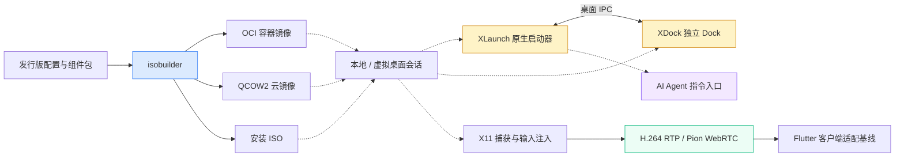

  

<h1 align="center">ai-desktop-lab</h1>

<strong>经典桌面交互 · AI 工作区入口 · 本地与远程桌面</strong> Classic Desktop Interaction · AI Workspace Entry Points · Local & Remote Desktops

  
  
  
  

<strong>🇨🇳 简体中文</strong> ｜ <a href="https://github.com/ai-desktop-lab/.github/blob/main/profile/README_EN.md">🌐 English Version</a>

---

## 🇨🇳 组织概览

`ai-desktop-lab` 聚焦 AI Workspace 生态中的桌面交互、系统镜像与远程桌面研发。我们以经典琥珀色桌面视觉为起点，把应用启动器、独立 Dock、Linux 镜像构建和远程桌面传输拆分为可独立演进的组件，探索从本地应用入口到远程 AI 工作区的统一体验。

### 我们的使命与研发准则

- **经典交互，面向 AI**：保留直观的应用菜单、搜索和快捷入口，逐步引入自然语言 Agent 指令。
- **组件独立，适配分层**：XDock 不依赖 XLaunch 或 Agent 运行时；平台差异由专用适配层处理。
- **可复现构建，多形态交付**：以发行版配置和脚本定义 OCI、云虚拟机与安装 ISO 的构建路径。
- **验证优先，边界透明**：明确区分原生实现、实验性构建和未来规划，不把设计目标等同于已验证兼容性。

### 常用访问入口

- **桌面项目**：[XLaunch](https://github.com/ai-desktop-lab/XLaunch) · [XDock](https://github.com/ai-desktop-lab/XDock)
- **镜像与远程接入**：[isobuilder](https://github.com/ai-desktop-lab/isobuilder) · [Remote Desktop](https://github.com/ai-desktop-lab/xworkmate-remote-desktop)
- **相关生态**：[AI Workspace Lab](https://github.com/ai-workspace-lab) · [AI Workspace Infra](https://github.com/ai-workspace-infra)

---

## 🏛️ 四大核心支柱 (Four Core Pillars)

<table>
<tr>
<td width="25%" align="center" valign="top">
  <h3>🚀 Native Launcher</h3>
  
<strong>XLaunch · 桌面入口</strong>

  
原生应用发现与启动、紧凑菜单与全屏应用网格；以经典 Amber 风格探索 AI 指令入口。

</td>
<td width="25%" align="center" valign="top">
  <h3>⚓ Classic Dock</h3>
  
<strong>XDock · 独立组件</strong>

  
C++17 + Qt Quick/QML 实现，提供应用固定、启动、主题切换、主机状态和日历交互。

</td>
<td width="25%" align="center" valign="top">
  <h3>📦 OS Packaging</h3>
  
<strong>isobuilder · 镜像构建</strong>

  
面向 Debian、Ubuntu、Fedora 与 Rocky Linux 的配置与构建定义，覆盖 OCI、QCOW2 和安装 ISO。

</td>
<td width="25%" align="center" valign="top">
  <h3>🌐 Remote Desktop</h3>
  
<strong>WebRTC · 远程交互</strong>

  
从 XWorkmate 提取的远程传输基线：X11 捕获、H.264 RTP、Pion WebRTC、输入注入与 Flutter 客户端适配代码。

</td>
</tr>
</table>

---

## 🔄 桌面生态架构与演进方向

> 实线表示仓库已描述的组件关系，虚线表示集成方向或规划；不代表完整端到端方案已经交付或通过验收。

---

## 📦 核心仓库矩阵 (4 Core Projects)

| 仓库 | 类型 / 定位 | 功能与当前边界 |
| :--- | :--- | :--- |
| [`XLaunch`](https://github.com/ai-desktop-lab/XLaunch) | `Native Launcher` | 原生 macOS 与 Linux/X11 启动器，支持应用发现、启动、菜单与全屏网格；更广泛的桌面适配及 Agent 指令能力按项目计划推进。 |
| [`XDock`](https://github.com/ai-desktop-lab/XDock) | `Classic Dock` | C++17 + Qt Quick/QML 独立 Dock，提供固定应用、主题、状态面板与日历；Linux X11/Wayland 集成仍需真实环境验证，运行窗口状态与系统托盘仍是后续工作。 |
| [`isobuilder`](https://github.com/ai-desktop-lab/isobuilder) | `OS Image Builder` | Debian / Ubuntu / Fedora / Rocky 构建配置，输出 OCI、QCOW2 与 ISO；不是已发布镜像集，RPM ISO 为实验性安装器骨架，完整桌面取决于匹配的组件包。 |
| [`xworkmate-remote-desktop`](https://github.com/ai-desktop-lab/xworkmate-remote-desktop) | `Remote Transport` | 从 XWorkmate App / Bridge 提取的服务端、协议与 Flutter 适配基线；尚非生产替代方案，独立信令、认证、客户端包和部署边界仍在完善。 |

### 平台与交付状态

- **桌面适配目标**：macOS 26+、GNOME、KDE Plasma、Xfce、DDE 等是研发目标，不是已验证的全平台支持声明；当前原生 Linux 交互重点包含 X11 / ICEWM。
- **远程捕获后端**：当前使用 X11 与 `xdotool`；PipeWire / portal 捕获和 libei 输入是后续方向。
- **镜像验收**：Debian / Ubuntu 默认 LightDM + ICEWM；Fedora / Rocky Live 桌面验收、原生组件 RPM 打包及云模板可用性仍需验证。
- **权威信息**：构建方法、平台兼容性与版本状态以各仓库 README、实现文档和 Releases 为准。

---

## 🤝 参与共建

欢迎通过对应仓库的 Issues 与 Pull Requests 参与原生桌面适配、交互设计、镜像构建和远程协议测试。提交问题时，请附操作系统、桌面环境、显示协议（X11 / Wayland）、组件版本与复现步骤。

<strong>经典 · 独立 · 可复现 · 开放 · 面向 AI</strong> Classic · Modular · Reproducible · Open · AI-Oriented

