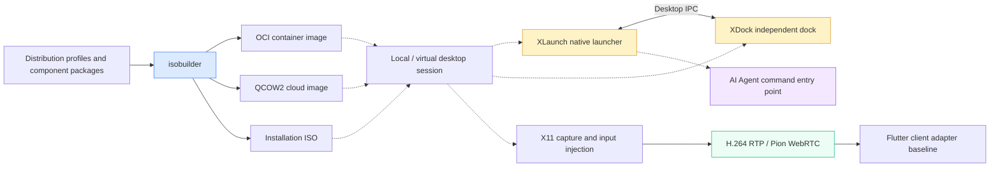

  

<h1 align="center">ai-desktop-lab</h1>

<strong>Classic Desktop Interaction · AI Workspace Entry Points · Local & Remote Desktops</strong>

  
  
  
  

<a href="https://github.com/ai-desktop-lab/.github/blob/main/profile/README.md">🇨🇳 简体中文</a> ｜ <strong>🌐 English Version</strong>

---

## 🌐 Organization Overview

`ai-desktop-lab` focuses on desktop interaction, system images, and remote desktop development within the AI Workspace ecosystem. Starting with a classic amber visual language, we develop application launchers, an independent dock, Linux image builders, and remote desktop transport as separately evolving components, exploring a consistent experience from local application entry points to remote AI workspaces.

### Mission & Development Principles

- **Classic interaction, AI-oriented**: Preserve intuitive application menus, search, and shortcuts while progressively introducing natural-language Agent commands.
- **Independent components, layered adapters**: XDock works without XLaunch or an Agent runtime; dedicated adapters handle platform differences.
- **Reproducible builds, multiple formats**: Distribution profiles and scripts define OCI, cloud VM, and installation ISO build paths.
- **Validation first, transparent boundaries**: Distinguish native implementations, experimental builds, and roadmap items. Design targets are not verified compatibility claims.

### Quick Links

- **Desktop projects**: [XLaunch](https://github.com/ai-desktop-lab/XLaunch) · [XDock](https://github.com/ai-desktop-lab/XDock)
- **Images & remote access**: [isobuilder](https://github.com/ai-desktop-lab/isobuilder) · [Remote Desktop](https://github.com/ai-desktop-lab/xworkmate-remote-desktop)
- **Related ecosystem**: [AI Workspace Lab](https://github.com/ai-workspace-lab) · [AI Workspace Infra](https://github.com/ai-workspace-infra)

---

## 🏛️ Four Core Pillars

<table>
<tr>
<td width="25%" align="center" valign="top">
  <h3>🚀 Native Launcher</h3>
  
<strong>XLaunch</strong>

  
Native app discovery and launching, a compact menu and fullscreen grid, with an AI command entry point as a design direction.

</td>
<td width="25%" align="center" valign="top">
  <h3>⚓ Classic Dock</h3>
  
<strong>XDock</strong>

  
Independent C++17 + Qt Quick/QML implementation for pinned apps, launching, themes, host status, and calendar interaction.

</td>
<td width="25%" align="center" valign="top">
  <h3>📦 OS Packaging</h3>
  
<strong>isobuilder</strong>

  
Profiles and build definitions for Debian, Ubuntu, Fedora, and Rocky Linux, covering OCI, QCOW2, and installation ISO formats.

</td>
<td width="25%" align="center" valign="top">
  <h3>🌐 Remote Desktop</h3>
  
<strong>WebRTC transport</strong>

  
An extraction baseline from XWorkmate: X11 capture, H.264 RTP, Pion WebRTC, input injection, and Flutter client adapter code.

</td>
</tr>
</table>

---

## 🔄 Desktop Architecture & Evolution

> Solid lines describe component relationships documented in the repositories; dashed lines indicate integration directions or roadmap items. This is not a claim of a delivered, validated end-to-end solution.

---

## 📦 Core Repository Matrix (4 Core Projects)

| Repository | Role | Features & Current Boundaries |
| :--- | :--- | :--- |
| [`XLaunch`](https://github.com/ai-desktop-lab/XLaunch) | `Native Launcher` | Native macOS and Linux/X11 launcher with app discovery, launching, menus, and a fullscreen grid. Broader desktop adapters and Agent commands remain part of the project roadmap. |
| [`XDock`](https://github.com/ai-desktop-lab/XDock) | `Classic Dock` | Independent C++17 + Qt Quick/QML dock with pinned apps, themes, status panel, and calendar. Linux X11/Wayland integration needs live validation; running-window state and system tray services remain follow-up work. |
| [`isobuilder`](https://github.com/ai-desktop-lab/isobuilder) | `OS Image Builder` | Debian / Ubuntu / Fedora / Rocky profiles for OCI, QCOW2, and ISO outputs. Not a collection of released images; RPM ISO is an experimental installer scaffold, and a complete desktop requires compatible component packages. |
| [`xworkmate-remote-desktop`](https://github.com/ai-desktop-lab/xworkmate-remote-desktop) | `Remote Transport` | Server, protocol, and Flutter adapter baseline extracted from XWorkmate App / Bridge. Not a production replacement; standalone signaling, authentication, client packaging, and deployment boundaries remain incomplete. |

### Platform & Delivery Status

- **Desktop targets**: macOS 26+, GNOME, KDE Plasma, Xfce, and DDE are development targets, not verified universal support. Current native Linux interaction includes an X11 / ICEWM focus.
- **Remote capture**: The current backend uses X11 and `xdotool`; PipeWire / portal capture and libei input are future directions.
- **Image acceptance**: Debian / Ubuntu default to LightDM + ICEWM. Fedora / Rocky Live desktop acceptance, native component RPM packaging, and cloud template availability still need validation.
- **Source of truth**: Consult each project's README, implementation documentation, and Releases for build instructions, compatibility, and version status.

---

## 🤝 Contributing

Contribute through the relevant repository's Issues and Pull Requests: platform adapters, interaction design, image builds, and remote protocol tests are welcome. For bug reports, include your OS, desktop environment, display protocol (X11 / Wayland), component version, and reproduction steps.

<strong>Classic · Modular · Reproducible · Open · AI-Oriented</strong>

